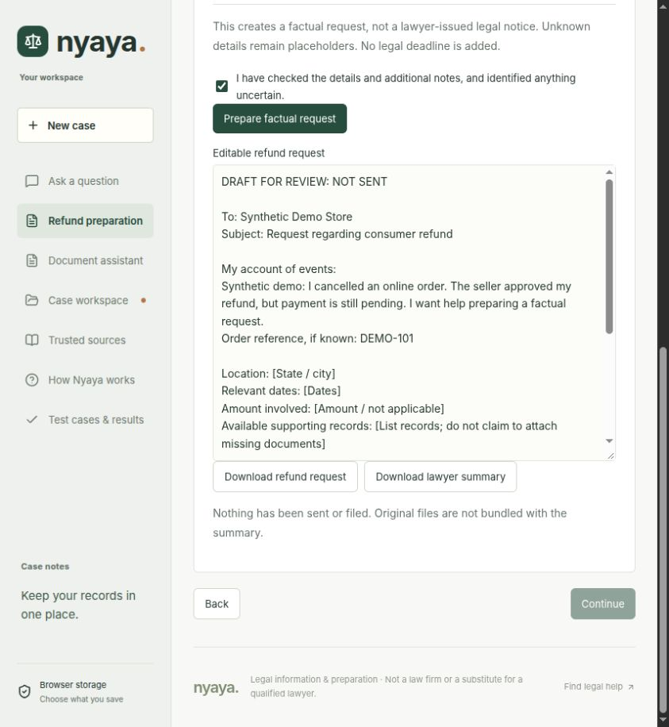

# Nyaya: understand your problem, prepare your next step

An India-focused legal-information and case-preparation **web app** for **Problem 2 of the Kuku FM AI Generalist assignment**. Turn a messy account into checked facts, evidence, practical options and an editable factual request. The deepest workflow is **consumer refunds**.

[Hosted demo](https://kukufm-ai-generalist.onrender.com/) · [50-case benchmark](https://kukufm-ai-generalist.onrender.com/benchmarks) · [User guide](https://kukufm-ai-generalist.onrender.com/how-it-works) · [Submission walkthrough](docs/SUBMISSION.md)

**Branch status:** `main` contains the submitted Node/Next.js version. The hosted demo currently runs the separate `render-deploy` branch; subsequent submission fixes are not live there. This update does not push that branch or change the existing Sites deployment. Earlier Sites source remains in Git history at [`c7f3986`](https://github.com/rpyaduvanshi950/KukuFm_AI_Generalist/tree/c7f3986).

## What works

| Need | Implemented behaviour |
| --- | --- |
| Describe a problem | Text conversation in English or Hindi; Hinglish included in authored evaluations |
| Build a case | Reviewed fact suggestions, evidence checklist, manual timeline and case notes |
| Understand records | PDF, DOCX, text and image attachments; inspect extracts and matched quotations |
| Act on a refund | Four stages: account, missing details, records/options, confirmation and editable request |
| Prepare other matters | Factual deposit/salary requests; cyber, domestic-safety and notice preparation briefs |
| Take it to an adviser | Download the request, lawyer briefing or structured case export |
| Handle uncertainty | Scope limits, urgent referral, explicit unknowns and labelled guided fallback |

Supporting scope includes rental deposits, unpaid salary, cyber incidents, domestic safety, notices and supplied property/contract documents. Nyaya does not determine entitlement, authenticate documents, calculate legal deadlines, file cases or contact anyone. Court pleadings, full legal notices and complex disputes require a lawyer.

Text satisfies the assignment's “text or voice” requirement. Voice, additional Indian languages and opposing-side practice are not implemented. Some navigation, checklists and source notes remain English. This submission prioritises one completed journey over claiming comprehensive coverage.



## Run locally

Requires **Node.js 22.13+** and npm.

```sh
git clone https://github.com/rpyaduvanshi950/KukuFm_AI_Generalist.git
cd KukuFm_AI_Generalist
git switch main
npm ci --include=dev --include=optional
npm run dev
```

Open **http://127.0.0.1:5173**. With no key, the app uses labelled **guided mode**. Case preparation, local extraction and exports work without paid AI; generated document interpretation does not.

Production build:

```sh
npm run build
npm start
```

Open **http://localhost:3000**. Hosting binds `0.0.0.0` and uses `PORT`. No sign-in is required.

## Configure AI privately

Copy `.env.example` to **`.env.local`** and set:

```dotenv
DATABASE_URL=your_private_postgresql_connection_url
AI_BASE_URL=https://api.openai.com/v1
AI_MODEL=gpt-5.4-mini-2026-03-17
AI_API_KEY=your_private_provider_key
```

Use a dedicated PostgreSQL database. For development, run `npm run db:migrate` before `npm run dev`. Production `npm start` applies versioned migrations automatically. Restart after changing environment settings. For a custom domain, set `APP_ORIGIN` to its HTTPS origin. See [Render deployment instructions](RENDER.md).

The production spending guard supports the model above, not arbitrary providers/pricing. Earlier provider adapters remain for historical evaluation; the hosted request path allows only the priced OpenAI endpoint. No downloaded legal model is bundled.

Keys stay server-side. Never use `NEXT_PUBLIC_` for secrets or commit `.env.local`, `.env.openai.local` or `.dev.vars`. No actual credentials are included. A missing key never triggers a provider request. Missing/unavailable usage tracking pauses paid responses and preserves guided help.

## How invented law is reduced

1. Deterministic routing checks topic, selected urgency signals, fabrication requests and explicit foreign jurisdiction.
2. The model receives a small, versioned pack of official-source summaries and scope limits. Legal information must come from that pack rather than remembered laws/cases.
3. Checks reject unknown references, unsupported section patterns, generated links, selected case-citation patterns and outcome promises. The server supplies source URLs.
4. Quotations and suggested facts must match supplied text. Document answers distinguish **supported**, **contradicted**, **not established** and **unclear**. Conflicting records must not be silently reconciled.
5. Failed provider/validation responses become labelled guided information. No automatic retries, key rotation or invented replacement citations.

These safeguards do not prove legal correctness. Quote matching does not establish semantic support, authenticity, enforceability or territorial applicability. The library is not live or comprehensive. Urgent notices, hearings, arrest risk, disputed rights and consequential documents need qualified review. **Independent Indian legal review is pending.** See [source scope](SOURCE_REGISTER.md) and [review handoff](docs/LEGAL_REVIEW.md).

## Attachments and privacy

Up to **3 files**, **10 MB each**, with **36,000 combined text characters** per request:

| Format | Reading limits |
| --- | --- |
| PDF | First 20 pages of text, at most 18,000 characters/file; selected-page image reading for scans |
| DOCX | Main-body paragraphs/table text; not complete layout, headers, comments or embedded images |
| TXT / MD / CSV | Text, at most 18,000 characters/file |
| JPG / PNG / WebP | Reduced image for unverified vision, maximum 1,800-pixel side |

Files are processed in browser memory. Consent is required before sending extracted text or a reduced image to the provider. Selected-page reading sees only that page. Review warnings, redact identifiers and compare quotations with originals.

PostgreSQL stores usage counters/reservations, not case content. Optional unencrypted browser saving stores selected facts, not full conversations, files or specialist notes. Downloads remain on the device. Provider/infrastructure retention policies still apply. [Operations and privacy](OPERATIONS.md) gives details.

## Tests and raw outputs

```sh
npm test
npm run test:render
npm run typecheck
npm run build
npm run test:postgres:local
npm run test:http
```

The final two commands create temporary PostgreSQL, require its binaries (default `/usr/lib/postgresql/16/bin`, or `POSTGRES_BIN`) and make no paid AI calls. Build before `test:http`. Software tests preserve recorded benchmark outputs; disposable diagnostics go to a temporary directory.

| Evidence | Meaning |
| --- | --- |
| [50 cases](benchmarks/v5/cases.json), [raw development](benchmarks/v5/results/development.json), [raw final](benchmarks/v5/results/final.json), [report](benchmarks/v5/REPORT.md) | Historical comparison: 44/50 combined mechanical checks, 15/20 first reserved final. Splits used different snapshots; not current legal accuracy |
| [Submission cases](benchmarks/submission/cases.json), [raw outputs](benchmarks/submission/results.json), [report](benchmarks/submission/REPORT.md) | Ten later regressions: first run 7/10; separate offline replay after fixes. Not an unseen holdout |
| [Public benchmark provenance](benchmarks/ATTRIBUTION.md) | Small English ContractNLI/LegalBench sample, not comprehensive Indian-law validation |
| [Review sheet](benchmarks/v5/REVIEW.csv) | Prepared for a qualified reviewer; currently ungraded |

No perfect-accuracy, lawyer-approved or market-leading claim is made. [Submission verification](docs/VERIFICATION.md) separates live, local and historical checks.

Paid evaluation is separate from `npm test`. `npm run benchmark:submission` defaults to a no-network preview. Explicit `--run` uses private `OPENAI_API_KEY`, refuses to overwrite results and caps that run at **10 requests/$0.10**. Use a new version for another paid evaluation.

## Architecture and deployment

Next.js App Router, React, TypeScript and Node.js 22; PostgreSQL for persistent usage limits. `lib/legal.mjs` handles routing/templates; `lib/knowledge.mjs` the source pack; `lib/assistant.mjs` prompting/validation; `lib/documents.ts` browser extraction; `/api/chat` provider requests and budget reservation.

Shared allowance: **$0.50 and 100 attempts per UTC day**, plus **40 attempts per UTC hour**. Reservations are atomic; settlement is idempotent; unknown usage retains its reservation. This is conservative local accounting, not a provider billing guarantee or per-user abuse protection.

[RENDER.md](RENDER.md) covers deployment. `/api/health` reports liveness; `/api/status` reports provider availability separately. This is an assignment demonstration, not a production legal service.
